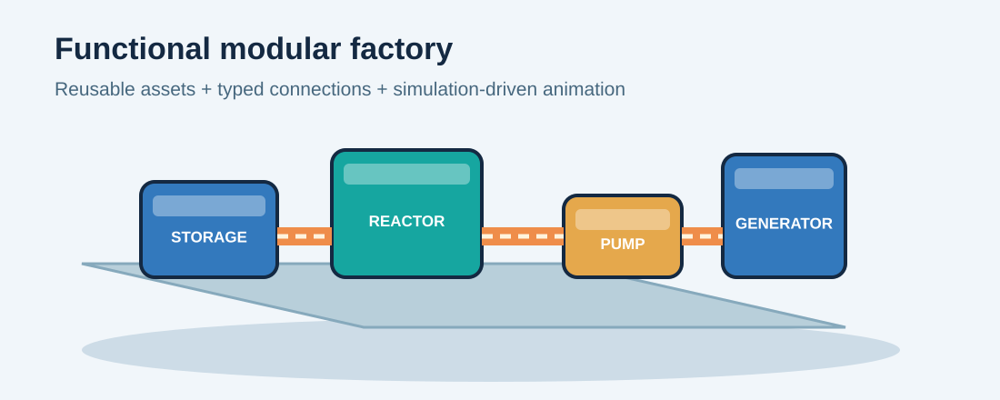
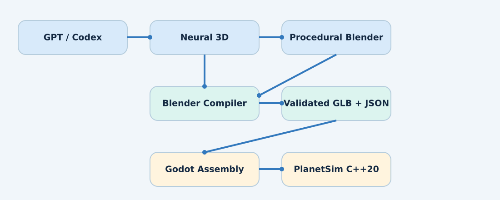
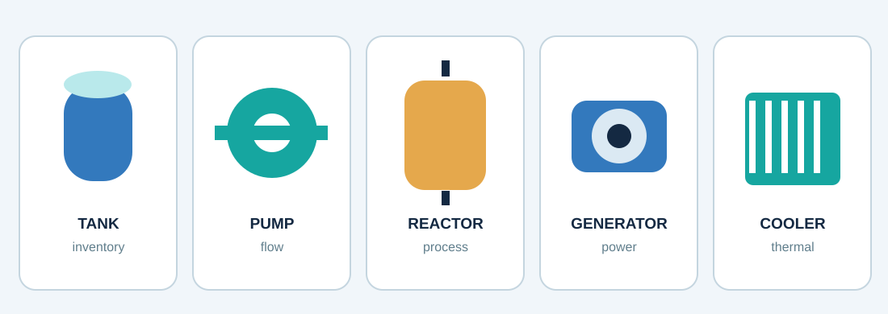

# Planet Game - AssetForge Architecture

**Version 1.0 | 29 October 2026 | Technical design proposal**



## Executive summary

AssetForge is an AI-assisted *offline development* pipeline for Planet Game. GPT/Codex writes asset specifications and procedural Blender generators. Neural image-to-3D backends create irregular visual meshes. Blender normalizes, validates, optimizes and exports assets. Godot 4 assembles assets at runtime based on functional blueprints; the authoritative standalone C++20 PlanetSim determines all physical, industrial and environmental behavior. **No language model or neural 3D model is shipped in the game runtime.**

The architecture preserves the existing Planet Game engineering sandbox: Materials, Processes, Components, typed Ports, Connections and hierarchical Blueprints; deterministic mass/energy accounting; knowledge-driven improvements; environmental coupling; Godot rendering with GDExtension/godot-cpp and headless C++20 simulation. PC remains the primary target, with Android adaptation later.

## 1. System architecture



| Stage | Responsibility | Output |
|---|---|---|
| GPT / Codex | Specify assets, write procedural generators and validation tests | Versioned JSON and Python |
| Concept-image stage | Supply appearance references for irregular assets | Approved image references |
| Neural 3D backend | Generate visual mesh and material candidates | Raw meshes and textures |
| Blender procedural backend | Create precise machinery, structural modules and connectors | Parametric geometry |
| Blender asset compiler | Normalize transforms, UVs, LODs, rigging, colliders and materials | Validated scene / GLB |
| Asset registry | Track semantic metadata, origin and dependencies | GLB + JSON + provenance |
| Godot 4 | Assemble, animate, visualize, route pipes/cables | Runtime scenes |
| PlanetSim C++20 | Authoritative processes, flows, resources, environmental effects | Deterministic state snapshots |

### Separation rules

1. The simulation must build and run without Godot, Blender, or any AI tools.
2. Mesh appearance must never define physical laws or override simulation results.
3. Functional ports and process definitions have stable identifiers shared by simulation and visual bindings.
4. Asset generation is offline; runtime assembly is deterministic and bounded by validated rules.
5. All generated content is reviewable, reproducible and license-traceable.

## 2. Asset categories and production strategies

| Category | Preferred technique | Reason |
|---|---|---|
| Industrial machinery, factories | Blender Python / Geometry Nodes | Accurate ports, pivots, dimensions and modularity |
| Rocks, vegetation, decorative objects | Image-to-3D neural backend | Irregular organic forms |
| Roads, pipes, wires, conveyors | Godot procedural runtime assembly | Dynamic connections and junction routing |
| Vehicles and robots | Hybrid neural visual shell + procedural mechanical parts | Articulated movement and predictable physics |
| Terrain and planetary surfaces | Existing PlanetSim/planet generator pipeline | Planet-scale deterministic coupling |



### Neural backend policy

Begin with TRELLIS.2 as a *research prototype*, not a hard dependency. A model adapter should expose input image, seed, quality profile, output mesh, materials and provenance. Evaluate license terms before commercial use. In particular, the TRELLIS.2 project page contains a research/noncommercial-use disclaimer; Hunyuan3D-2.1's published community license excludes the EU. Do not assume generated meshes are production-ready. Ensure fallback to entirely procedural generation.

## 3. Functional asset contract

The defining concept is that a game asset carries **geometry + functional anchors + animation controls + material slots + validated metadata**, while PlanetSim owns the actual physical behavior.

An electric generator might expose mechanical input, electrical output and coolant input. Blender contains `PORT_MECH_IN`, `PORT_ELEC_OUT`, `PORT_COOLANT_IN` transforms and `ANIM_ROTOR`; an accompanying manifest references those nodes. The simulation determines power, temperature, wear and efficiency. Godot maps those values to rotor rotation, gauges, emission effects and heat tinting.

Example proposed manifest:

```json
{
  "id": "generator_electric_v1",
  "type": "machine",
  "geometry": "generator.glb",
  "dimensions_m": [2.0, 1.5, 1.8],
  "components": ["housing", "rotor", "stator", "cooling_system"],
  "ports": [
    {"id": "mechanical_input", "type": "mechanical_power", "node": "PORT_MECH_IN"},
    {"id": "electric_output", "type": "electrical_power", "node": "PORT_ELEC_OUT"},
    {"id": "coolant_input", "type": "fluid", "node": "PORT_COOLANT_IN"}
  ],
  "animations": {"rotor_speed": "ANIM_ROTOR", "temperature": "MAT_HEAT"}
}
```

This is a **visual asset manifest**, not a replacement for PlanetSim's existing process schema. A binding/validation layer resolves semantic IDs, verifies port compatibility, and checks the transform names against imported GLB nodes.

## 4. Procedural factory assembly

An engineering blueprint describes processes and typed connections. A deterministic layout solver chooses footprints and placement, selects approved machine-module variants, routes fluid pipes / power cables / conveyor paths, then Godot instantiates the visual assembly. The solver checks port orientation, clearances, connectivity and feasible routing. It may report that a blueprint is impossible to lay out rather than inventing geometry.

### Reusable functional modules

| Module | Connections / state |
|---|---|
| Tank | Material inventory, fill level, temperature |
| Pump | Fluid input/output, electrical draw, throughput |
| Reactor | Process inputs/outputs, heat, pressure, emissions |
| Generator | Mechanical/fuel input, electrical output, thermal losses |
| Conveyor | Item flow, speed, utilization |
| Heat exchanger | Thermal and fluid interfaces |
| Research station | Knowledge production and technology unlocks |
| Pollution-control system | Emission treatment, waste and energy use |

Three separate records are maintained: **functional blueprint** (semantics), **physical layout** (position/dimensions/routing) and **visual skin** (geometry/materials/animations). This allows fictionally invented equipment to be expressed through known component templates, without making arbitrary image-generation output physically authoritative.

## 5. Blender asset compiler

Compile process: import/generate -> normalize units/origin/transforms -> clean topology -> generate UV/materials -> build LOD and collision -> install functional anchors/pivots -> prepare animations -> validate -> export GLB, JSON and preview.

Validation includes: missing nodes/ports, dimensions, axis convention, attachment placement, duplicate semantic IDs, material/texture references, animation tracks, render budgets, collision geometry and Godot import smoke tests. Manifoldness checks depend on object category; open leaves or surfaces need not be watertight.

Blender `.blend` is the editable source; `.glb` is the interchange artifact. Core glTF supports meshes, textures, common PBR channels and animations. A stable Blender version should be pinned by the build environment.

Example CLI:

```bash
python tools/asset_pipeline/cli/build_asset.py \
    --spec assets/specifications/electric_generator.json \
    --quality high --target godot
```

## 6. Godot and PlanetSim bindings

Godot scenes contain foundation, modules, connection segments and visual effects. PlanetSim publishes a per-component state frame (e.g., flow, electric output, temperature, pressure, degradation, emissions). The visual binding maps each state variable to animation speed, shader parameters, indicators or particles. Render state is observational: it cannot feed authoritative state back by accident.

Runtime asset assembly is driven by deterministic seeds plus versioned blueprint and asset IDs; the same saved game should reconstruct the same arrangement. PlanetSim serialization contains no engine-owned pointers. Expensive rendering detail can be suppressed without changing production behavior.

## 7. Source layout

```text
planet_game/
  tools/asset_pipeline/
    cli/ generators/{blender,neural}/
    processors/{geometry,materials,rigging,lod}/
    validators/ exporters/
  assets/
    specifications/ sources/{procedural,neural}/
    library/{machines,buildings,infrastructure,vehicles,vegetation,terrain}/
    generated/
  godot/
    procedural_assembly/ asset_registry/ simulation_visualization/
  tests/assets/
```

Maintain per-asset provenance: generator and commit versions, seeds, parameters, source images, licensing, model name, hashes, toolchain version and validation report. Keep large binaries in artifact storage or Git LFS while tracking definitions and scripts with Git.

## 8. Hardware strategy

Codex and Blender can run on the existing workstation. Neural 3D generation should use a queued, replaceable GPU worker with a local or remote implementation. TRELLIS.2 typically needs a high-VRAM NVIDIA device; the existing RTX 4070 Ti may not support full-quality runs. GPU availability must not block procedural asset builds or headless simulation tests.

## 9. Roadmap and acceptance criteria

**Phase 1: Procedural foundation.** Create schemas, compiler interface, Blender builder, validation and Godot import. Deliver a generator with at least three typed ports and an animated pivot.

**Phase 2: Neural integration.** Add concept-image-to-mesh adapter, processing, provenance and licensing review. Deliver one approved organic decorative asset imported by the same pipeline.

**Phase 3: Factory assembly.** Connect the engineering graph, layout solver, port routing and state-driven visuals. Deliver a five-module tank/pump/reactor/generator/cooler chain with deterministic save/load.

**Phase 4: Production scaling.** Add batch generation, searchable previews, human approval, cache, LOD policy and regression tests. Deliver repeatable asset builds from source specifications.

### First end-to-end proof of concept

Generate Tank, Pump, Reactor, Generator and Cooler; connect them using their typed ports; produce an automatic footprint and routed pipelines; simulate an operating state in PlanetSim; animate flow, rotor speed, temperature and emissions; modify one blueprint parameter and verify a deterministic re-assembly. Every output passes validation and a Godot import test.

## 10. Design decisions

- Three modules: `AssetForge.Generate` (offline procedural/neural creation), `AssetForge.Compile` (Blender processing, export and validation), `AssetForge.Assemble` (Godot deterministic layout and binding).
- **No GPT or neural 3D inference in the shipped runtime.**
- Gameplay physics, chemistry and economy remain exclusively in PlanetSim.
- Neural meshes are candidates for human approval, not semantically reliable machine definitions.
- Use typed port transforms and stable identifiers as the integration contract.
- Introduce a reproducible and license-aware asset registry from day one.

## References (checked October 2026)

- Microsoft TRELLIS.2 project: https://microsoft.github.io/TRELLIS.2/
- TRELLIS repository: https://github.com/microsoft/TRELLIS
- Tencent Hunyuan3D-2.1 license: https://github.com/Tencent-Hunyuan/Hunyuan3D-2.1/blob/main/LICENSE
- Godot 3D scene formats: https://docs.godotengine.org/en/stable/tutorials/assets_pipeline/importing_3d_scenes/available_formats.html
- Blender glTF exporter: https://docs.blender.org/manual/en/latest/addons/import_export/scene_gltf2.html

*The vector illustrations in this document are original schematic concepts, not generated production 3D meshes.*
